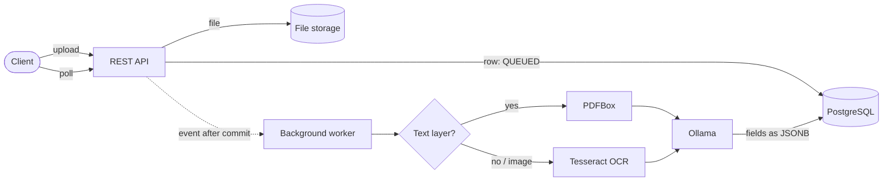

# docuextract

[](https://github.com/ARDAVAN39/docuextract/actions/workflows/ci.yml)

A small backend service that turns PDFs and images into structured JSON. You upload an invoice,
receipt, contract or letter; the service reads its text (with OCR when the file is a scan) and asks
a language model running locally in [Ollama](https://ollama.com) to pull out fields such as the
document type, date, issuer and total amount.

Everything runs on your own machine. No document leaves it and no API key is needed.

```
POST /api/v1/documents  (invoice.pdf)
        │
        ▼
{
  "status": "COMPLETED",
  "extractedFields": {
    "documentType": "invoice",
    "title": "Invoice 2026-001",
    "date": "2026-03-14",
    "issuer": "Acme S.r.l.",
    "recipient": "Example GmbH",
    "totalAmount": 120.5,
    "currency": "EUR",
    "language": "en",
    "summary": "Invoice for consulting services in March 2026."
  }
}
```

## How it works



1. **Upload.** The file type is detected from the file's first bytes, not from its name or
   `Content-Type` header. The file is stored, a row is written with status `QUEUED`, and the API
   answers `202 Accepted` straight away.
2. **Text.** A background worker reads the document. PDFs with a text layer are read directly with
   PDFBox. Scanned PDFs and images go through Tesseract.
3. **Fields.** The text is sent to Ollama with a prompt that fixes the output keys. The answer is
   validated and stored in a `JSONB` column.
4. **Result.** The client polls the document until it is `COMPLETED` or `FAILED`. A failed document
   keeps its error message and can be reprocessed.

## Run it

You need Docker.

```bash
docker compose up --build -d

# pull a model once (about 2 GB)
docker compose exec ollama ollama pull llama3.2
```

Then upload a document:

```bash
curl -i -F "file=@invoice.pdf" http://localhost:8080/api/v1/documents
# HTTP/1.1 202 Accepted
# Location: /api/v1/documents/7b1f...

curl http://localhost:8080/api/v1/documents/7b1f...
```

The interactive API documentation is at <http://localhost:8080/swagger-ui.html>.

## API

| Method | Path | Description |
|---|---|---|
| `POST` | `/api/v1/documents` | Upload a file (multipart field `file`). Returns `202` and a `Location` header. |
| `GET` | `/api/v1/documents/{id}` | Status and extracted fields. |
| `GET` | `/api/v1/documents/{id}/text` | The plain text read from the document. `409` until processing has finished. |
| `GET` | `/api/v1/documents?status=&page=&size=` | List documents, newest first. |
| `POST` | `/api/v1/documents/{id}/reprocess` | Run a completed or failed document again. |
| `DELETE` | `/api/v1/documents/{id}` | Delete the document and its stored file. |

Supported files: PDF, PNG, JPEG and TIFF, up to 20 MB. Errors are returned as
[RFC 9457](https://www.rfc-editor.org/rfc/rfc9457) problem details.

## Configuration

All settings can be set through environment variables.

| Variable | Default | Meaning |
|---|---|---|
| `DB_URL` | `jdbc:postgresql://localhost:5432/docuextract` | PostgreSQL JDBC URL |
| `DB_USER` / `DB_PASSWORD` | `docuextract` | Database credentials |
| `STORAGE_DIR` | `./data/uploads` | Where uploaded files are kept |
| `OLLAMA_URL` | `http://localhost:11434` | Ollama base URL |
| `OLLAMA_MODEL` | `llama3.2` | Model used for field extraction |
| `OCR_LANGUAGE` | `eng` | Tesseract language(s), for example `eng+ita` |
| `TESSERACT_BINARY` | `tesseract` | Name or path of the Tesseract executable |

To read documents in another language, install the matching Tesseract language pack in the image
(for example `tesseract-ocr-ita`) and set `OCR_LANGUAGE`.

## Design decisions

**Processing is asynchronous.** OCR plus a local model can take from a few seconds to a minute. The
upload request does not wait for it. The worker is triggered by an event that is delivered only
after the upload transaction commits, so it never looks for a row that does not exist yet. No
database transaction is held open while OCR or the model is running.

**The model's answer is treated as untrusted input.** Ollama is asked for JSON, but the answer still
has to parse as a JSON object. Unknown keys are dropped and missing keys are set to `null`, so
clients always get the same shape. Anything else marks the document `FAILED` with a readable
reason.

**Tesseract runs as a separate process**, not through a JNI binding. A crash or a hang in the OCR
engine costs one process and is bounded by a timeout. The JVM stays up.

**OCR only when needed.** Most PDFs produced by software already contain their text. Reading it
directly is faster and exact, so OCR is the fallback, not the default.

**Storage and the model sit behind small interfaces** (`FileStorage`, `OcrEngine`,
`FieldExtractor`). The local-disk storage can be replaced with Azure Blob Storage or S3, and Ollama
with another model API, without changing the pipeline.

## Tests

```bash
mvn verify
```

- Unit tests cover type detection, storage, text extraction, the Ollama client (against a mock HTTP
  server) and the processing pipeline.
- `DocumentControllerTest` covers the HTTP layer with MockMvc.
- `DocumentFlowIntegrationTest` starts the whole application against a real PostgreSQL in
  [Testcontainers](https://testcontainers.com) and follows a document from upload to result. It
  needs Docker and is skipped when Docker is not available. Only the model is replaced by a stub.

## Limitations and next steps

- Work in progress is kept in memory. If the service restarts while documents are queued, they stay
  `QUEUED` until someone calls `reprocess`. A startup sweep or a real queue would fix that.
- One fixed set of fields. Per-document-type schemas (invoice lines, contract parties) would be the
  next feature.
- No authentication. The service is meant to run behind another service or on a private network.
- Files are stored on local disk. An object-storage implementation of `FileStorage` is the obvious
  addition for running more than one instance.

## Tech stack

Java 21 · Spring Boot 3.5 · PostgreSQL 16 · Flyway · Hibernate · Apache PDFBox · Tesseract ·
Ollama · Testcontainers · Docker · GitHub Actions

## License

[MIT](LICENSE)
